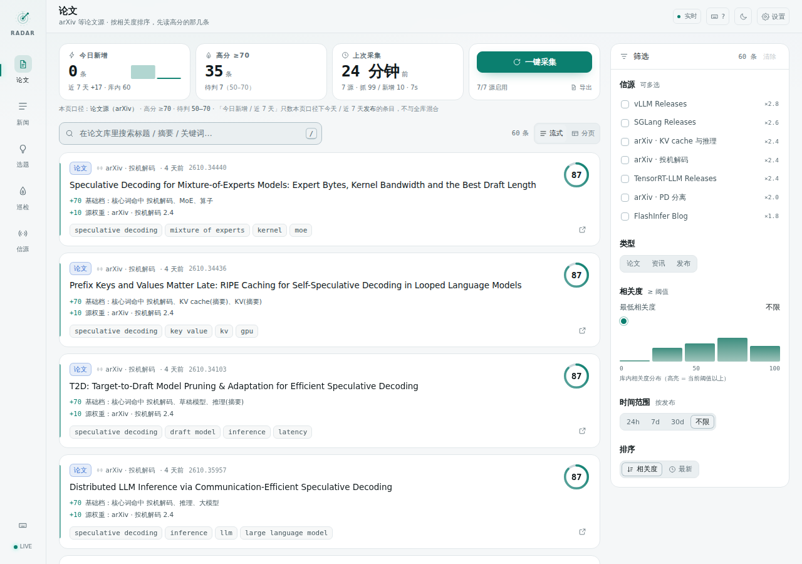
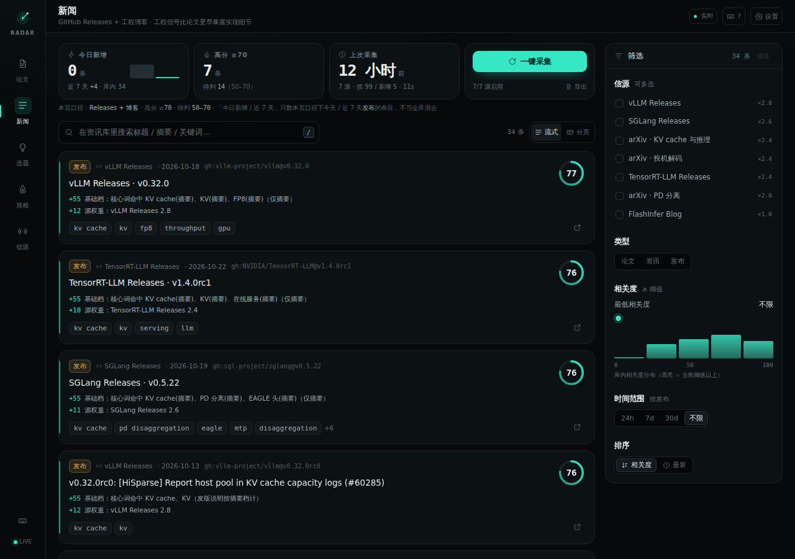
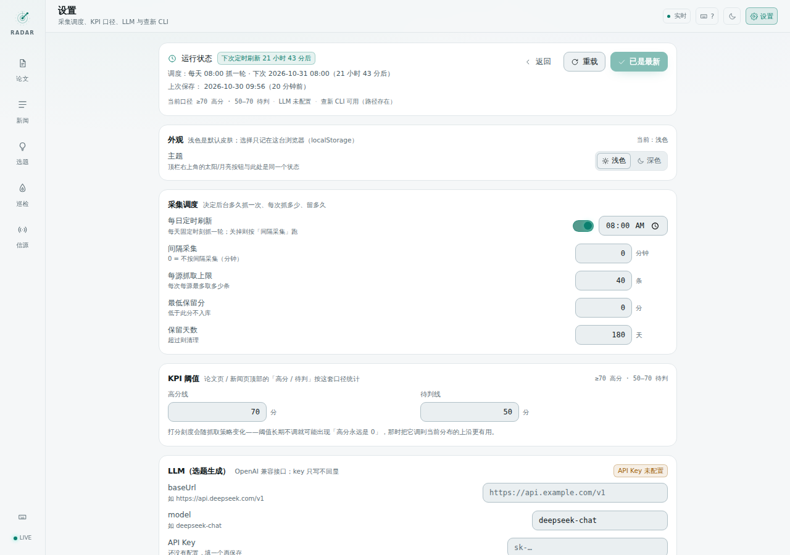
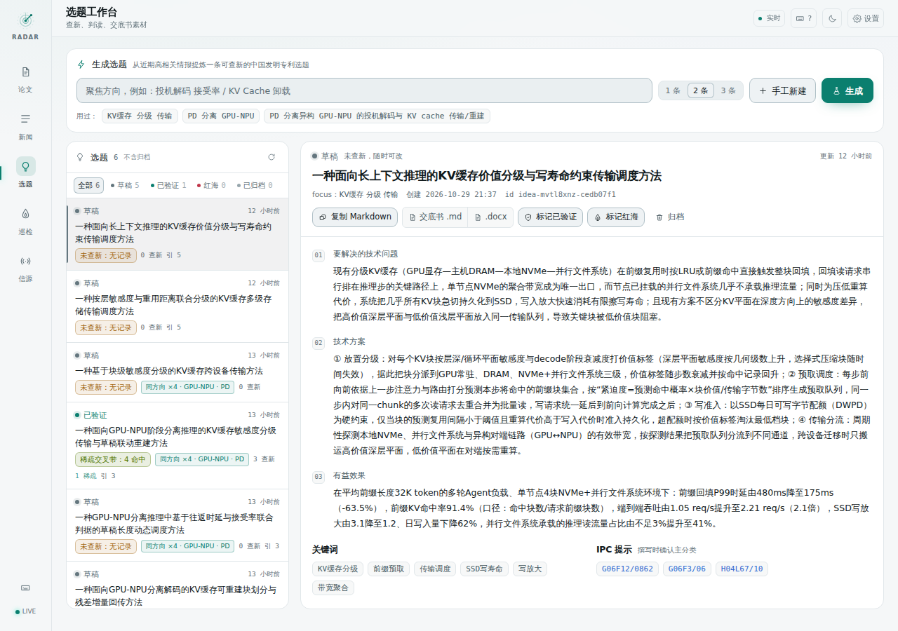
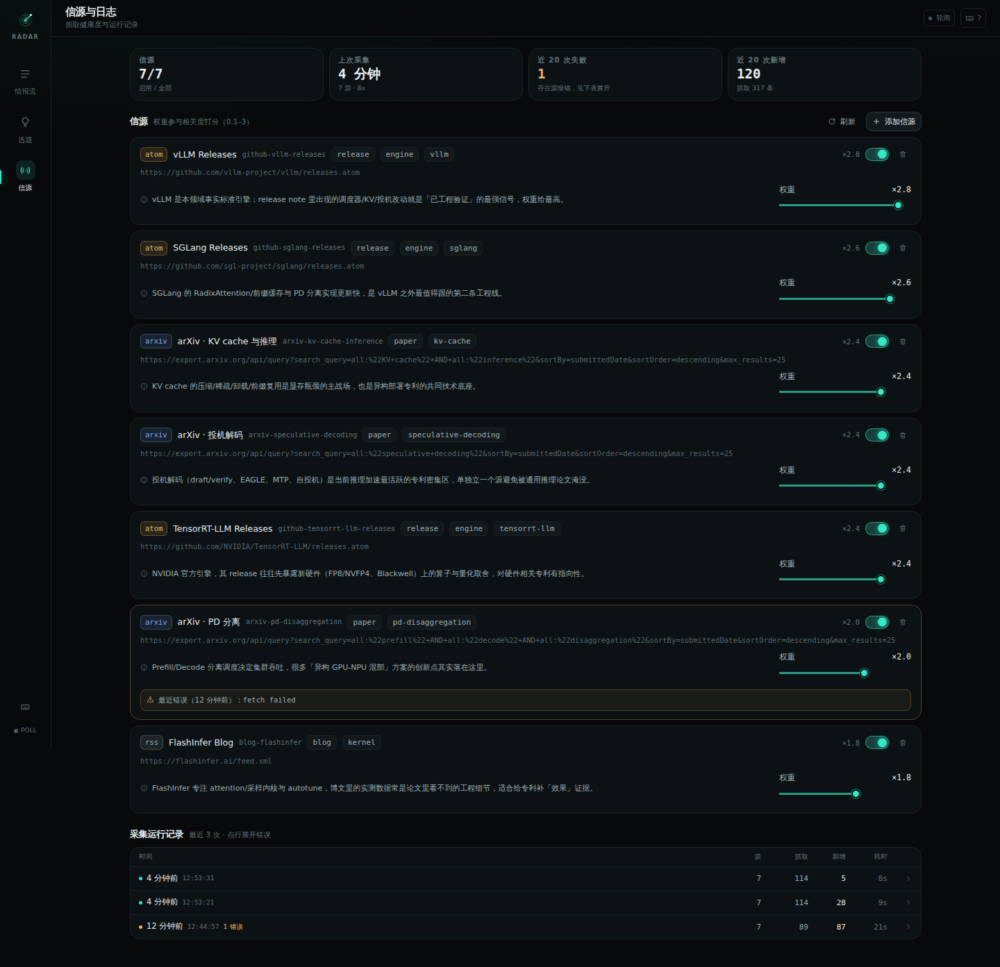
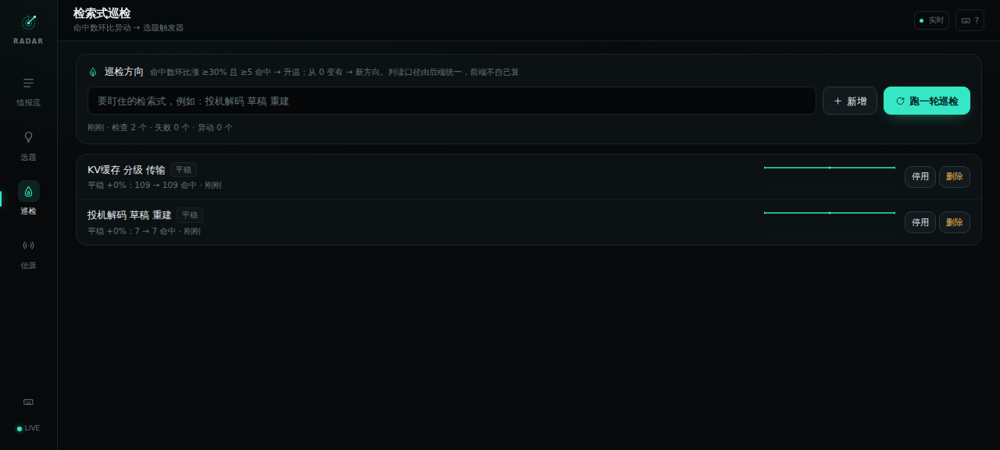
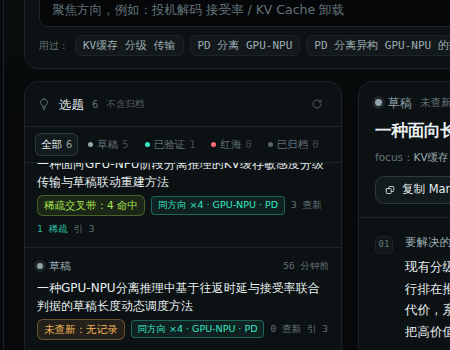
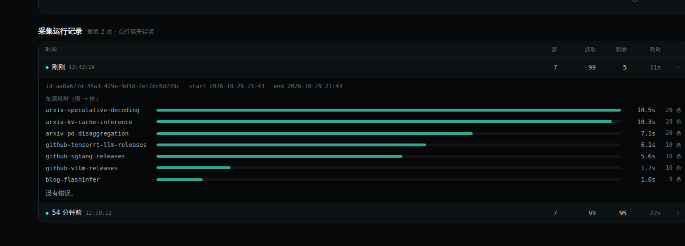

<div align="center">

# Trend Radar · 技术情报雷达

**把每天几百篇 arXiv 和工程发布，压成几条值得读的情报，再压成一条可查新的中国发明专利选题。**

聚合 arXiv / GitHub Releases / RSS → 可解释相关度打分 → 专利选题生成 → 智慧芽查新判读

### 论文（arXiv 等论文源）



### 新闻（RSS 新闻源 + 技术博客）



### 设置（右上角齿轮）



### 选题工作台（含真实查新判读）



### 信源与运行日志



> 截图数据来源：情报条目与信源权重是真实抓取（arXiv / GitHub Releases / FlashInfer），
> 选题正文与检索式由真实 LLM 生成，查新命中数与头部申请人来自智慧芽实际检索结果。

</div>

---

## 它解决什么问题

做技术情报和专利选题的人，日常是这个循环：

1. 每天 arXiv cs.LG/cs.CL/cs.DC + 十几个工程博客，几百条，**读完就没时间干活**；
2. RSS 阅读器只按时间排序，**不告诉你哪条和你的技术方向有关**；
3. 好不容易想到一个点，去智慧芽一查，华为已经布了 21 件——**白忙一周**；
4. 换个方向再查，命中 0，以为是处女地，其实是**检索式写太窄**（简单搜索是 AND 语义，5 个词必然全零）。

Trend Radar 把这四步串成一条流水线，并且**每一步都留下可复核的证据**：为什么这条情报得了 87 分、这条选题的检索式命中了多少件、判读为什么是「有机会」而不是「空白」。

## 核心能力

**⓪ 对话助手（`#/chat`）**
看板内置聊天框：用自然语言问「最近投机解码有什么值得读的」「KV cache 压缩专利布局如何」「基于最近高分情报生成 3 条选题」，
助手自动编排七个工具——库内检索 / arXiv 实时检索 / Google Patents 专利检索（免鉴权）/ 选题流水线 /
交底书导出链接 / 查新（智慧芽已配置真查新，否则摘要已有判读）/ 权利要求草案（独权 1 + 从属 3–5，落库），
回答流式输出、结论先行、带 [n] 引用来源；检索结果一律当数据不当指令（防提示注入），检索不到就明说，不编造。
会话持久化：带 sessionId 即落库，跨刷新可回看/续聊/删除（会话面板）；巡检可选 Google Patents 引擎
（免智慧芽盯竞对，`assignee:公司名` 语法实验性）；可选 Bark 每日推送（近 24h 高分 Top5 + 新选题数）。

**① 浅色/深色双主题，随时切换**
默认浅色（白卡 + 深墨字，正文对比度 17.8:1），顶栏太阳/月亮或设置页都能切，选择存在 localStorage、
刷新不闪（`<head>` 内联脚本先于模块脚本恢复）。配色全部收口到 token（`bg-white/*`、`bg-black/*` 已 grep 归零），
深色皮肤完整保留。

**② 论文与新闻是两页，不混在一起**
`#/papers` 只出论文源（arXiv），`#/news` 只出 RSS 新闻与技术博客（后端 `kinds=news` 过滤；
Releases 在查询层排除——数据源保留、照常打分入库，独立展示见下方「工程动态」章节）。
两页 KPI 只统计自己的口径——论文页的「高分」不会把 GitHub 发版算进去。旧书签 `#/feed` 自动重写到 `#/papers`。

**③ 每天定时刷新（在设置页改）**
`HH:mm` 每日定点 / 每 N 分钟间隔 / 关闭，三态由后端 `refreshMode` 决定，设置页改完立即重排定时器、**不用重启**。
定时器 `unref()` 不占句柄，设置落 SQLite（`settings` 表），重启后仍生效。

**④ 右上角齿轮 = 全部配置**
采集调度、每源上限、保留分与 TTL、KPI 高分/待判线、LLM baseUrl/model/API Key、查新 CLI 路径，全在一个页面。
**API Key 永不回传明文**（只回 `hasApiKey`）；`hasCommand` 是"路径真的存在"而不是"填过"；后端 400 的字段错误会落到对应输入框下面。

**⑤ 多源聚合 + 可解释打分**
情报源（arXiv 关键词订阅 / GitHub Releases / RSS）并发抓取、单源失败不影响整轮、跨源去重（归一化 URL + arXiv id）。
每条情报给出 0–100 分和**打分理由明细**（关键词命中、源权重、时效衰减、工程信号、噪音惩罚），不做黑箱排序。

**⑥ 专利选题生成**
给定技术焦点 + 一批高分情报，用 LLM 产出符合专利撰写口径的选题：技术问题 / 多特征技术方案 / 量化有益效果 / IPC 提示 / 撞车风险，并强制附带 **3 条等词数的中文查新检索式**（词数一致才能横向比命中数）。
生成结果做结构校验：字段缺失、IPC 非法、检索式词数不齐的条目会被**丢弃并记录原因**，不会整批失败也不会悄悄放行。

**⑦ 查新判读（这是最容易糊弄的地方）**
把智慧芽的命中数按机械规则判读成四档，**判断权交给规则，不交给感觉**：

| 判读 | 触发条件 | 含义 |
|---|---|---|
| `red-ocean` | 任一检索式 ≥50 命中 | 主线已被占（通常是大厂），换交叉点 |
| `opportunity` | 有 1–5 命中的稀疏交叉带，且无红海 | 空位信号，值得精读最近邻权利要求 |
| `gap` | 存在 0 命中且非全零 | 缺口方向，但需人工确认不是检索式问题 |
| `inconclusive` | **全部 0 命中** 或全部解析失败 | **不判空白**——先怀疑检索式/术语 |

> 第 4 档是踩过坑之后加的：曾经把「检索式过窄导致全零」记成「技术空白」，差点据此立项。
> 现在全零会自动减词重试一次（仍 ≥3 词），仍全零就老实标 `inconclusive`。

**⑧ 检索式巡检：把「事后查新」变成「事前预警」**
选题查新是写完才验证，往往发现红海已经晚了。巡检盯住若干固定检索式，每轮记录命中数快照，
按机械规则判读趋势：`升温`（≥30% 且命中 ≥5）/ `新方向冒头`（0 → 有）/ `降温` / `平稳` / `基线`。
命中数异动的方向会自动进入 `alerts`，这才是选题触发器。

Web 端有独立「巡检」页：命中数折线、档位徽标、一键跑一轮，每个方向还能直接**出选题**（把检索式当 focus 交给 LLM，生成后跳到工作台并选中）；CLI 同样可用：

```bash
trend-radar watch add "投机解码 草稿 重建"   # 盯住一个方向
trend-radar watch list                      # 看最近命中数与巡检次数
trend-radar sweep                            # 跑一轮，输出趋势判读
```



> 解析失败（页面改版）记为 `null` 而不是 0，趋势判读会跳过它——否则一次改版就会把趋势算成「暴跌 100%」。

**⑨ 手工也能写**
LLM 未配置时不是空壳：`POST /api/ideas` 让用户自己把想法结构化进工作台（同样走校验与判读），
未查新就明确标 `无法判断：未查新`，不会假装有结论。

**⑩ 一键导出专利交底书**
选题通过查新后可直接导出九章结构的交底书，**Markdown + Word(.docx) 双格式**（发明名称 / 技术领域 / 背景缺陷 / 技术方案分条 / 附图说明 / 具体实施方式 / 查新记录 / IPC / 情报来源）。
.docx 由**零依赖手写 OOXML + ZIP** 生成（不引 `docx` 包），`python-docx` 与 `file` 均验证可正常打开。
缺什么就写「（待补）」——**不编造实验数据和附图**；查新记录里 `0（零命中）` 与 `解析失败` 分开标注，避免交底书被当成"从没查过"或"查过是空白"。

**⑪ 同方向选题一眼看出来**
工作台对选题做**方向聚类**（中文二元组 + 技术词集合相似度，零依赖、结果可解释），
同方向的条目打 `同方向 ×4 · GPU-NPU · PD` 徽标，hover 列出同簇标题——
避免把同一方向当两个方向分别写交底书，或者以为撞车了。



**⑫ 采集慢在哪，一眼看得到**
每条运行记录都能展开看**每源耗时条**（慢 → 快排序，失败源标红并带错误）：
真实一轮 7 源 99 条 = arXiv 10.5s/10.3s/7.1s、GitHub Atom 1.7–6.1s、博客 1.0s，
"22 秒采集"到底是哪个源拖的，不再靠猜。



**⑬ 全链路可复现**
每条选题记录生成时用的 `focus` 快照、引用了哪些情报条目、prompt 版本号；每条查新记录保留检索式原文、命中数、头部申请人画像、原始备注。

## 快速开始

```bash
git clone https://github.com/sunchendd/trend-radar.git && cd trend-radar
npm ci                        # 锁文件里是公网 registry；内网加 --registry=<你的镜像>
cp .env.example .env          # 想用选题生成就填 LLM_BASE_URL / LLM_API_KEY
npm run build
npm start                     # http://127.0.0.1:8787
```

**判断「真的跑通了」的 5 条**（本仓库在干净 clone 上实测过，2026-10-29）：

| 命令 | 期望 |
|---|---|
| `npm ci` | 223 包，无原生编译（`node:sqlite`，不需要 python/gcc） |
| `npm test` | `Tests 216 passed`，全程不出网、不调外部 CLI |
| `npm run build` | `web/dist/assets/index-*.js ≈ 378 KB` |
| `curl :8787/api/health` | `{"ok":true,...}`；首页 `assets/*.js` 的 Content-Type 是 `application/javascript` |
| `POST /api/collect` | 首次空库：`fetched 99 / added 95 / errors 0`，`perSource` 显示每源耗时 |

开发模式（前后端热更新；仅前端开发用，侧边栏/反代链路不需要它）：

```bash
npm run dev:server            # API :8787
npm run dev:web               # Web  :5273（/api 已代理）——生产与侧边栏均不走此端口
```

Docker：

```bash
docker compose up --build     # 数据持久化在 ./data
```

首次启动没有任何数据，点界面上的「采集」或跑：

```bash
npm run collect --workspace server
```

## 在 DSH 侧边栏打开（macOS）

仓库自带 `dsh-plugin/`，可以把看板装进 DeepSeek Harness 侧边栏（面板名「情报雷达」）：
服务进程按需拉起（`127.0.0.1:8787`，detached，DSH 重启后仍在）、`/trend-radar/*`
同源反代（SSE 流式直通，采集完成后看板自动更新）、`POST /api/trend-radar` 动作路由，
以及 8 个 `trend_*` 模型工具（自旧工具桥同名迁移）。**不需要 Vite 5273**——
插件只跑 `npm run build` 的产物，`dev:web` 仅前端开发时才需要。

安装三步：

```bash
# ① 构建产物（本仓库根目录）
npm install --no-audit --no-fund
npm run build                  # server/dist/index.js + web/dist/

# ② 装进 desktop profile：CLI 不能管理 desktop profile（rejectElectronProfile），
#    用团队脚本（幂等、先备份、绝不触碰运行中的 GUI 进程）：
bash ../scripts/activate-desktop.sh --dry-run   # 预览将做的编辑
bash ../scripts/activate-desktop.sh             # 编辑 profile package.json + pnpm install

# ③ 你自己重启 DeepSeek Harness（⌘Q 退出 → Dock 重新打开），
#    侧边栏出现「情报雷达」，点开即用。
```

配置在 `dsh-plugin/cordis.patch.yml`（默认零配置即可用）：

| 键 | 默认 | 说明 |
|---|---|---|
| `port` | `8787` | 服务端口，只绑 `127.0.0.1`；外部访问一律走 `/trend-radar` 反代 |
| `repo` | 自动探测 | 仓库根（`dsh-plugin/` 上一级）；仅仓库挪动后才需显式指定 |
| `dataDir` | `~/.trend-radar` | sqlite 数据目录，与旧工具桥同目录，数据无缝继承 |

排查表（503 / 白屏 / 端口占用 / SSE 不更新）见 [dsh-plugin/README.md](dsh-plugin/README.md)；
架构与激活方案详见 `reports/02-architecture.md`。

> 侧边栏链路的实现细节（按需拉起、反代分流、工具迁移）见 `dsh-plugin/index.js` 顶部注释。

## 配置

全部通过环境变量（见 `.env.example`）：

| 变量 | 默认 | 说明 |
|---|---|---|
| `PORT` / `HOST` | `8787` / `127.0.0.1` | 监听地址 |
| `TREND_RADAR_DATA_DIR` | `./data` | sqlite 数据目录 |
| `COLLECT_MINUTES` | `360` | 自动采集间隔，`0` = 只手动 |
| `LIMIT_PER_SOURCE` | `40` | 单源抓取条数上限 |
| `LIMIT_PER_NEWS_SOURCE` | `20` | 新闻类 RSS（tags 带 news）单源上限，取 min(通用上限, 本值) |
| `TTL_DAYS` | `180` | 条目保留天数 |
| `LLM_BASE_URL` / `LLM_API_KEY` / `LLM_MODEL` | — | OpenAI 兼容端点，用于生成选题与自动翻译 |
| `ZHY_COMMAND` | — | 智慧芽查新 CLI（不配则手工录入命中数） |
| `TREND_TRANSLATION_DISABLED` | `0` | 设 `1` 时翻译默认关闭（设置页仍可改） |
| `TREND_TRANSLATION_DAILY_LIMIT` | `500` | 每日翻译条数上限的初始默认值 |

**没有 LLM 也能用**：聚合、看板、手工登记查新、判读规则全部离线可用；只有「生成选题」「自动查新」和「自动翻译」需要外部服务——生成/查新未配置时接口返回 `503` 并在界面提示；翻译未配置时**静默降级**（不报错，列表回落原文，设置页给配置指引）。

## 自动中文翻译（论文 / 新闻）

采集落库后，后台自动把**论文摘要全文、新闻正文全文、release note 全文（markdown 保留结构）**
的标题与正文翻译成中文（LLM 复用设置页的 baseUrl / model / apiKey，OpenAI 兼容 chat completions）。
默认模型 **GLM-5.3-Flash**（智谱 coding plan 订阅）：翻译/抽取批次自动携带
`thinking:{type:"disabled"}` 关闭思考模式（实测省 ~90% token 与等待；
`TREND_LLM_THINKING_DISABLED=0` 可关）。列表默认显示中文视图（工具栏可切回原文，选择记忆）。
智谱订阅 key 注意：**coding plan 的 key 必须用 coding 端点**
`https://open.bigmodel.cn/api/coding/paas/v4`，标准 paas/v4 端点会对订阅 key 报 1113 余额不足。

- **省配额**：多条合并成一次请求（默认 8 条/批）；标题或摘要含 CJK 的条目自动跳过；
  已翻译且内容未变的条目跳过（幂等）；原文内容变更（重抓后不一致）自动重译。
- **配额保护**：每日上限（设置页可改，默认 **2000 条/日**，全量翻译口径）是硬闸，达到即停；
  LLM 429/5xx 走客户端统一退避重试，单批解析失败自动重试一次，仍失败计入
  `failed` 留给下一轮。
- **UI**：论文/新闻页工具栏有「原文 / 中文」切换（localStorage 记忆），卡片与
  详情抽屉优先展示译文并标注「译」，抽屉里可展开查看原文；设置页有开关、每日
  上限、「翻译今日」手动触发与状态行（今日已翻 / 待翻 / 上次错误）。
- **接口**：`GET /api/translation/status`（状态一览）、`POST /api/translation/run`
  （手动触发一轮；关闭状态下返回 422 `translation_disabled`）。
- **降级**：LLM 未配置时整条链路静默降级——采集照常、列表照常，只是没有译文，
  设置页给出配置指引，不会报错刷屏。

## 工程动态（GitHub Releases 技术要点）

GitHub Releases 从新闻页独立成 `#/releases`「工程动态」页（导航第三项：论文/新闻/工程动态）。
每个 release 卡片展示：仓库 + 版本号 + 技术点分类标签（调度/KV/投机/量化/算子/并行/硬件/其他）
+ 中文要点 bullets + 原文链接 + 发版时间；页面 KPI：今日发版数 / 技术点总数 / 待抽取 / 今日额度。

- **双路径抽取**：配置了 LLM 时优先用模型把 release note（markdown）提炼成结构化要点
  （优先「相对上一版新增/变化」的改动，跳过纯文档/CI 更新）；未配置 LLM 时走**规则兜底**
  ——解析 Features/Changes section + 关键词归类（scheduler/KV cache/speculative/
  quantization/kernel/parallelism/H100/FP8…），保证无 LLM 也有可用产出。
- **协同**：抽取与翻译共用每日配额池与异步管线（采集落库后自动预抽，进入页面懒触发补缺）；
  release 摘要复用翻译的 `summaryZh`。
- **幂等**：内容指纹（release 正文变了才重抽）；同版本不重复抽取。
- **新闻页口径**：release 三源（vLLM/SGLang/TensorRT-LLM）从 `#/news` 移出，由本页承载；
  数据源保留、专利选题打分仍读全量条目不受影响；flashinfer 博客留在新闻页。
- **接口**：`GET /api/extraction/status`（状态 + KPI）、`POST /api/extraction/run`
  （手动/懒触发；LLM 未配置自动走规则兜底）。

## 内置信源清单（48 个：42 活跃 + 6 死源留档）

工程信号源 7 个（weight 1.8–2.8，服务论文页与专利选题）：

| 源 | 类型 | weight | 说明 |
|---|---|---|---|
| arXiv · 投机解码 / KV cache 与推理 / PD 分离 | arXiv 关键词订阅 ×3 | 2.0–2.4 | 论文页主体 |
| vLLM / SGLang / TensorRT-LLM Releases | GitHub Releases ×3 | 2.4–2.8 | 「已工程验证」信号；独立展示见「工程动态」规划 |
| FlashInfer Blog | RSS | 1.8 | 内核/autotune 一手经验，留在新闻页 |

新闻源 41 个（t19，weight 1.0–1.4，全部 tags 带 `news` + 分类；数据源清单来自
good_skills/skills/daily-newsletter，逐条对齐用户指定清单）：

| 分类 | 数量 | weight | 源 |
|---|---|---|---|
| 中文科技（china-tech） | 14 | 1.2–1.4 | 36氪 / 品玩 / IT之家 / 51CTO / AppSo / 量子位 / AIGC.cn / SSD爱好者 / 极客公园 / 雷峰网 / 爱范儿 / 虎嗅 / 钛媒体 / 创业邦 |
| 国际科技（tech） | 8 | 1.2–1.3 | TechCrunch / WIRED / The Verge / Ars Technica / Engadget / Gizmodo / CNET / ZDNet |
| 区块链（crypto） | 8 | 1.0–1.1 | CoinDesk / 币安博客（中/英）/ OKX 学习（中/英）/ Cointelegraph / Decrypt / The Block |
| 游戏（gaming） | 4 | 1.0 | GamesIndustry.biz / Polygon / Kotaku / IGN（feeds.ign.com 官方联合 feed，t23 替换已 404 的 ign.com/rss） |
| AI 官方（ai） | 3 | 1.4 | OpenAI Blog / Anthropic Blog / Google DeepMind Blog |
| 开发者（dev） | 4 | 1.2–1.3 | GitHub Blog / Stack Overflow Blog / DEV Community / HackerNoon |

- 新闻类 RSS 单源上限 `LIMIT_PER_NEWS_SOURCE`（默认 20），低于工程源配额——背景面不稀释新闻页密度；
- 打分不受影响：新闻条目走同一套关键词规则，源权重贡献压在 +0–+3（工程源 +7–+12）；
- 首次启动灌库 + 升级合并迁移（store v4）双路径：已装库把缺失默认源幂等补入，
  用户改过的 enabled/weight 原样保留。

## 架构

```
┌────────────┐   并发抓取·单源隔离   ┌──────────────┐
│  sources/  │ ────────────────────► │   score.ts   │  可解释打分
│ arxiv/atom │                       │  5 条规则     │
│    /rss    │                       └──────┬───────┘
└────────────┘                              │
                                            ▼
                                    ┌──────────────┐
                                    │ store (sqlite│  去重·TTL·分页
                                    │  node:sqlite)│
                                    └──────┬───────┘
                        ┌──────────────────┼──────────────────┐
                        ▼                  ▼                  ▼
                 ┌────────────┐    ┌────────────┐    ┌────────────┐
                 │  ideas/    │    │  http/     │    │  web/      │
                 │ 生成·查新  │    │ Fastify+SSE│◄──►│ React 看板 │
                 │ 判读规则   │    └────────────┘    └────────────┘
                 └────────────┘
```

模块边界与设计取舍见 [docs/architecture.md](docs/architecture.md)，HTTP 契约见 [docs/api.md](docs/api.md)。

## 主要接口

| 方法 | 路径 | 用途 |
|---|---|---|
| POST | `/api/collect` | 触发采集（幂等，同一时刻只跑一次） |
| GET | `/api/items` | 情报查询：关键词 / 源 / 类型 / 分数 / 排序 |
| GET | `/api/stats` | 看板统计（今日新增、近 7 天曲线、分数分布） |
| POST | `/api/chat` | **流式对话助手**：自然语言检索库内情报 / 实时查 arXiv / 查 Google Patents 专利 / 聊天直接生成专利选题（SSE，事件 status/sources/token/done/error，详见 `docs/api.md`「对话」节） |
| POST | `/api/ideas/generate` | 生成专利选题 |
| POST | `/api/ideas/:id/novelty` | 登记一条查新结果并重算判读 |
| POST | `/api/ideas/:id/novelty/auto` | 调智慧芽 CLI 批量查新 |
| GET | `/api/translation/status` | 翻译状态（开关/今日已翻/待翻/上次错误） |
| POST | `/api/translation/run` | 手动触发一轮翻译（LLM 未配置时 degraded） |
| GET | `/api/extraction/status` | 工程动态状态 + KPI（待抽取/技术点总数/今日发版） |
| POST | `/api/extraction/run` | 手动/懒触发 release 技术点抽取（规则兜底） |
| GET | `/api/events` | SSE 实时推送（采集完成 / 新增条目 / 选题变更） |

## 开发

```bash
npm run typecheck   # server + web 类型
npm test            # server 单测（vitest）
npm run build       # 构建 server(dist) + web(dist)
```

CI（GitHub Actions）跑：typecheck → test → build → 起服务 smoke test `/api/health`、`/api/stats`。

## 设计取舍

- **不接需要登录的平台**（小红书/抖音等）：这类数据要么违反平台条款，要么接口随时失效，做进产品里等于把可靠性押在别人的风控上。本项目只聚合**开放**情报源，源是可插拔的。
- **不用向量数据库**：情报量级（万级）用 sqlite + 关键词权重打分足够，且**打分可解释**比召回率高更有用——用户要看的是「为什么这条值得读」。
- **判读规则写在代码里、有单测**：避免"AI 说这个方向有空白"这种无法复核的结论。

## Roadmap

- [x] 检索式巡检（命中数环比异动 → 选题触发器，Web + CLI 双入口）
- [x] 巡检 → 选题闭环（异动方向一键出选题，`/#/watch` → `/#/ideas?idea=<id>`）
- [ ] 情报源做成运行时可视化配置（已支持增删启停，缺"探活预览"）
- [ ] 选题相似度聚类（现在只做标题 Jaccard 去重）
- [ ] 多语言检索式（英文检索式 + Google Patents 适配器）
- [x] 导出专利交底书 Markdown（九章结构，`GET /api/ideas/:id/disclosure`）
- [x] 交底书 Word(.docx) 导出（零依赖手写 OOXML）
- [ ] 交底书附图占位图生成
- [ ] 采集失败的告警通道（Webhook）

## License

MIT
