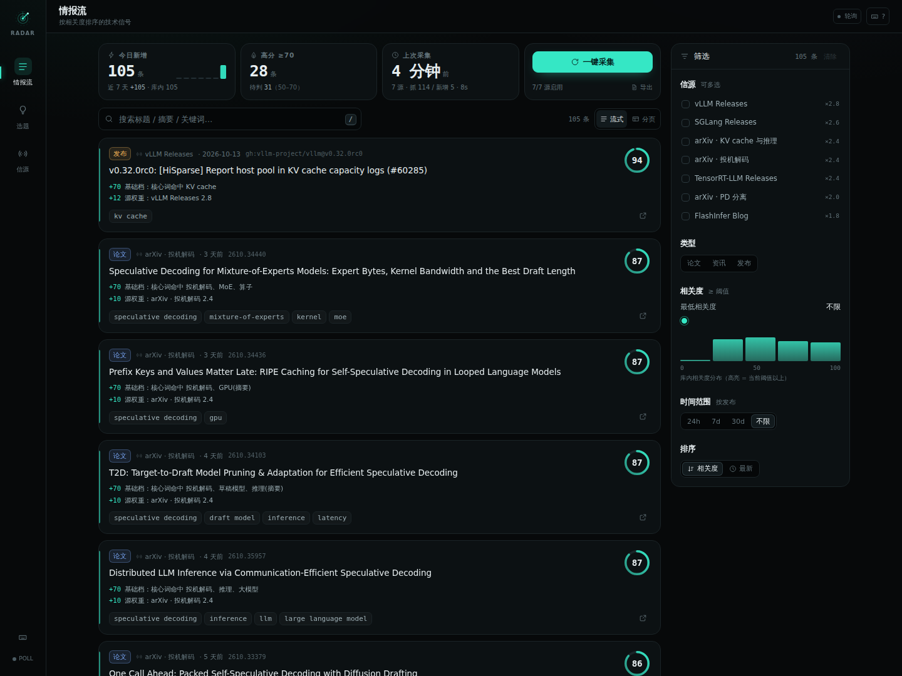
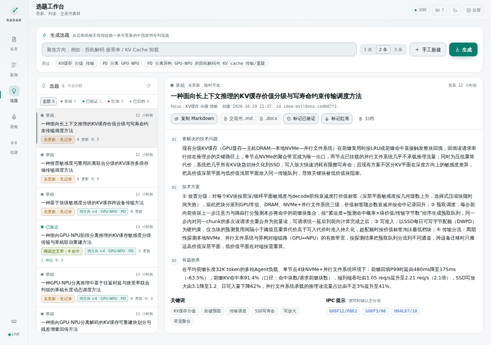
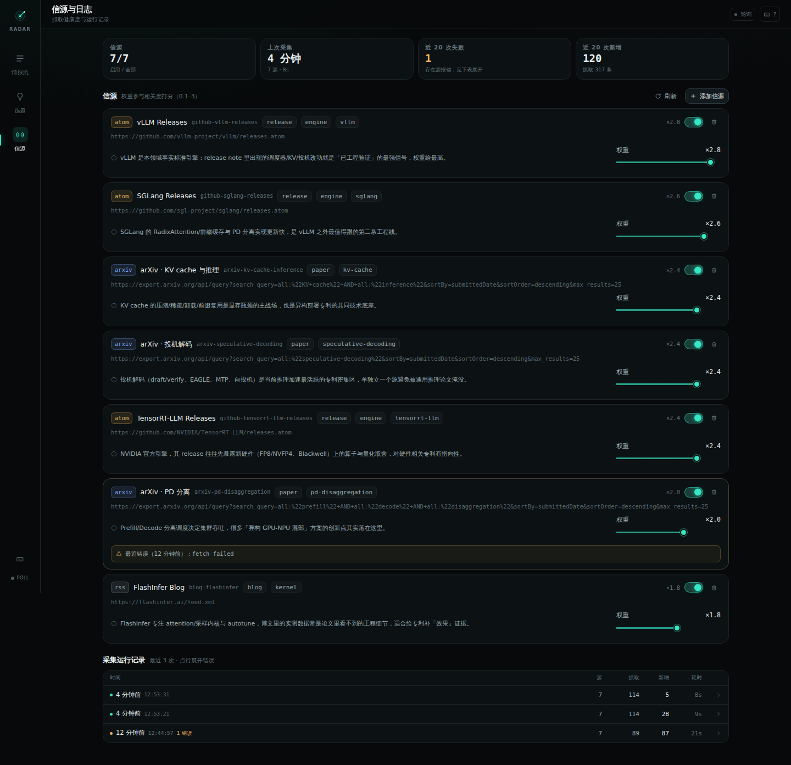
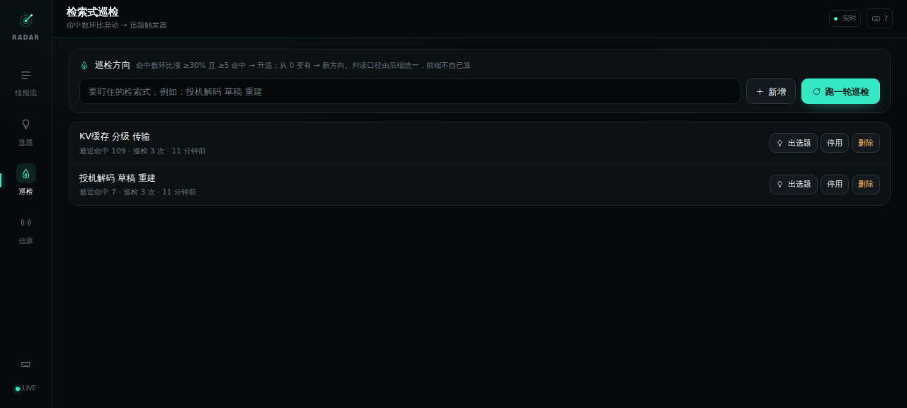

<div align="center">

# Trend Radar · 技术情报雷达

**把每天几百篇 arXiv 和工程发布，压成几条值得读的情报，再压成一条可查新的中国发明专利选题。**

聚合 arXiv / GitHub Releases / RSS → 可解释相关度打分 → 专利选题生成 → 智慧芽查新判读

### 情报流



### 选题工作台（含真实查新判读）



### 信源与运行日志



> 截图数据来源：情报条目与信源权重是真实抓取（arXiv / GitHub Releases / FlashInfer），
> 选题正文与检索式由真实 LLM 生成，查新命中数与头部申请人来自智慧芽实际检索结果。

</div>

---

## 它解决什么问题

做技术情报和专利选题的人，日常是这个循环：

1. 每天 arXiv cs.LG/cs.CL/cs.DC + 十几个工程博客，几百条，**读完就没时间干活**；
2. RSS 阅读器只按时间排序，**不告诉你哪条和你的技术方向有关**；
3. 好不容易想到一个点，去智慧芽一查，华为已经布了 21 件——**白忙一周**；
4. 换个方向再查，命中 0，以为是处女地，其实是**检索式写太窄**（简单搜索是 AND 语义，5 个词必然全零）。

Trend Radar 把这四步串成一条流水线，并且**每一步都留下可复核的证据**：为什么这条情报得了 87 分、这条选题的检索式命中了多少件、判读为什么是「有机会」而不是「空白」。

## 核心能力

**① 多源聚合 + 可解释打分**
情报源（arXiv 关键词订阅 / GitHub Releases / RSS）并发抓取、单源失败不影响整轮、跨源去重（归一化 URL + arXiv id）。
每条情报给出 0–100 分和**打分理由明细**（关键词命中、源权重、时效衰减、工程信号、噪音惩罚），不做黑箱排序。

**② 专利选题生成**
给定技术焦点 + 一批高分情报，用 LLM 产出符合专利撰写口径的选题：技术问题 / 多特征技术方案 / 量化有益效果 / IPC 提示 / 撞车风险，并强制附带 **3 条等词数的中文查新检索式**（词数一致才能横向比命中数）。
生成结果做结构校验：字段缺失、IPC 非法、检索式词数不齐的条目会被**丢弃并记录原因**，不会整批失败也不会悄悄放行。

**③ 查新判读（这是最容易糊弄的地方）**
把智慧芽的命中数按机械规则判读成四档，**判断权交给规则，不交给感觉**：

| 判读 | 触发条件 | 含义 |
|---|---|---|
| `red-ocean` | 任一检索式 ≥50 命中 | 主线已被占（通常是大厂），换交叉点 |
| `opportunity` | 有 1–5 命中的稀疏交叉带，且无红海 | 空位信号，值得精读最近邻权利要求 |
| `gap` | 存在 0 命中且非全零 | 缺口方向，但需人工确认不是检索式问题 |
| `inconclusive` | **全部 0 命中** 或全部解析失败 | **不判空白**——先怀疑检索式/术语 |

> 第 4 档是踩过坑之后加的：曾经把「检索式过窄导致全零」记成「技术空白」，差点据此立项。
> 现在全零会自动减词重试一次（仍 ≥3 词），仍全零就老实标 `inconclusive`。

**④ 检索式巡检：把「事后查新」变成「事前预警」**
选题查新是写完才验证，往往发现红海已经晚了。巡检盯住若干固定检索式，每轮记录命中数快照，
按机械规则判读趋势：`升温`（≥30% 且命中 ≥5）/ `新方向冒头`（0 → 有）/ `降温` / `平稳` / `基线`。
命中数异动的方向会自动进入 `alerts`，这才是选题触发器。

Web 端有独立「巡检」页：命中数折线、档位徽标、一键跑一轮，每个方向还能直接**出选题**（把检索式当 focus 交给 LLM，生成后跳到工作台并选中）；CLI 同样可用：

```bash
trend-radar watch add "投机解码 草稿 重建"   # 盯住一个方向
trend-radar watch list                      # 看最近命中数与巡检次数
trend-radar sweep                            # 跑一轮，输出趋势判读
```



> 解析失败（页面改版）记为 `null` 而不是 0，趋势判读会跳过它——否则一次改版就会把趋势算成「暴跌 100%」。

**⑤ 手工也能写**
LLM 未配置时不是空壳：`POST /api/ideas` 让用户自己把想法结构化进工作台（同样走校验与判读），
未查新就明确标 `无法判断：未查新`，不会假装有结论。

**⑥ 一键导出专利交底书**
选题通过查新后可直接导出九章结构的交底书 Markdown（发明名称 / 技术领域 / 背景缺陷 / 技术方案分条 / 附图说明 / 具体实施方式 / 查新记录 / IPC / 情报来源）。
缺什么就写「（待补）」——**不编造实验数据和附图**；查新记录里 `0（零命中）` 与 `解析失败` 分开标注，避免交底书被当成"从没查过"或"查过是空白"。

**⑦ 全链路可复现**
每条选题记录生成时用的 `focus` 快照、引用了哪些情报条目、prompt 版本号；每条查新记录保留检索式原文、命中数、头部申请人画像、原始备注。

## 快速开始

```bash
git clone https://github.com/<you>/trend-radar.git && cd trend-radar
npm install
cp .env.example .env          # 想用选题生成就填 LLM_BASE_URL / LLM_API_KEY
npm run build
npm start                     # http://127.0.0.1:8787
```

开发模式（前后端热更新）：

```bash
npm run dev:server            # API :8787
npm run dev:web               # Web  :5273（/api 已代理）
```

Docker：

```bash
docker compose up --build     # 数据持久化在 ./data
```

首次启动没有任何数据，点界面上的「采集」或跑：

```bash
npm run collect --workspace server
```

## 配置

全部通过环境变量（见 `.env.example`）：

| 变量 | 默认 | 说明 |
|---|---|---|
| `PORT` / `HOST` | `8787` / `127.0.0.1` | 监听地址 |
| `TREND_RADAR_DATA_DIR` | `./data` | sqlite 数据目录 |
| `COLLECT_MINUTES` | `360` | 自动采集间隔，`0` = 只手动 |
| `LIMIT_PER_SOURCE` | `40` | 单源抓取条数上限 |
| `TTL_DAYS` | `180` | 条目保留天数 |
| `LLM_BASE_URL` / `LLM_API_KEY` / `LLM_MODEL` | — | OpenAI 兼容端点，用于生成选题 |
| `ZHY_COMMAND` | — | 智慧芽查新 CLI（不配则手工录入命中数） |

**没有 LLM 也能用**：聚合、看板、手工登记查新、判读规则全部离线可用；只有「生成选题」和「自动查新」需要外部服务，未配置时接口返回 `503` 并在界面提示，不静默降级。

## 架构

```
┌────────────┐   并发抓取·单源隔离   ┌──────────────┐
│  sources/  │ ────────────────────► │   score.ts   │  可解释打分
│ arxiv/atom │                       │  5 条规则     │
│    /rss    │                       └──────┬───────┘
└────────────┘                              │
                                            ▼
                                    ┌──────────────┐
                                    │ store (sqlite│  去重·TTL·分页
                                    │  node:sqlite)│
                                    └──────┬───────┘
                        ┌──────────────────┼──────────────────┐
                        ▼                  ▼                  ▼
                 ┌────────────┐    ┌────────────┐    ┌────────────┐
                 │  ideas/    │    │  http/     │    │  web/      │
                 │ 生成·查新  │    │ Fastify+SSE│◄──►│ React 看板 │
                 │ 判读规则   │    └────────────┘    └────────────┘
                 └────────────┘
```

模块边界与设计取舍见 [docs/architecture.md](docs/architecture.md)，HTTP 契约见 [docs/api.md](docs/api.md)。

## 主要接口

| 方法 | 路径 | 用途 |
|---|---|---|
| POST | `/api/collect` | 触发采集（幂等，同一时刻只跑一次） |
| GET | `/api/items` | 情报查询：关键词 / 源 / 类型 / 分数 / 排序 |
| GET | `/api/stats` | 看板统计（今日新增、近 7 天曲线、分数分布） |
| POST | `/api/ideas/generate` | 生成专利选题 |
| POST | `/api/ideas/:id/novelty` | 登记一条查新结果并重算判读 |
| POST | `/api/ideas/:id/novelty/auto` | 调智慧芽 CLI 批量查新 |
| GET | `/api/events` | SSE 实时推送（采集完成 / 新增条目 / 选题变更） |

## 开发

```bash
npm run typecheck   # server + web 类型
npm test            # server 单测（vitest）
npm run build       # 构建 server(dist) + web(dist)
```

CI（GitHub Actions）跑：typecheck → test → build → 起服务 smoke test `/api/health`、`/api/stats`。

## 设计取舍

- **不接需要登录的平台**（小红书/抖音等）：这类数据要么违反平台条款，要么接口随时失效，做进产品里等于把可靠性押在别人的风控上。本项目只聚合**开放**情报源，源是可插拔的。
- **不用向量数据库**：情报量级（万级）用 sqlite + 关键词权重打分足够，且**打分可解释**比召回率高更有用——用户要看的是「为什么这条值得读」。
- **判读规则写在代码里、有单测**：避免"AI 说这个方向有空白"这种无法复核的结论。

## Roadmap

- [x] 检索式巡检（命中数环比异动 → 选题触发器，Web + CLI 双入口）
- [x] 巡检 → 选题闭环（异动方向一键出选题，`/#/watch` → `/#/ideas?idea=<id>`）
- [ ] 情报源做成运行时可视化配置（已支持增删启停，缺"探活预览"）
- [ ] 选题相似度聚类（现在只做标题 Jaccard 去重）
- [ ] 多语言检索式（英文检索式 + Google Patents 适配器）
- [x] 导出专利交底书 Markdown（九章结构，`GET /api/ideas/:id/disclosure`）
- [ ] 交底书 Word(.docx) 模板 + 附图占位图生成
- [ ] 采集失败的告警通道（Webhook）

## License

MIT
